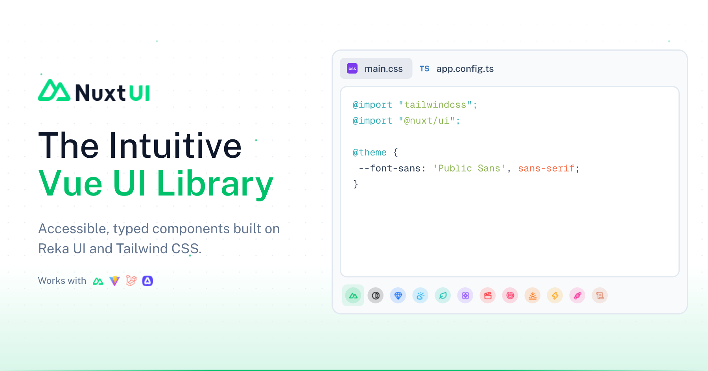

<picture>
  <source media="(prefers-color-scheme: dark)" srcset=".github/assets/banner-dark.png">
  <source media="(prefers-color-scheme: light)" srcset=".github/assets/banner-light.png">
  
</picture>

# Nuxt UI

[![npm version][npm-version-src]][npm-version-href]
[![npm downloads][npm-downloads-src]][npm-downloads-href]
[![License][license-src]][license-href]
[![Nuxt][nuxt-src]][nuxt-href]

Nuxt UI is a library of accessible, typed [Vue](https://vuejs.org) components built on [Reka UI](https://reka-ui.com/), [Tailwind CSS](https://tailwindcss.com/) and [Tailwind Variants](https://www.tailwind-variants.org/). It works as a module in [Nuxt](https://nuxt.com) and as a [Vite](https://vite.dev) plugin in plain Vue apps.

> [!NOTE]
> You are on the `v4` branch. Check out the [v3 branch](https://github.com/nuxt/ui/tree/v3) for Nuxt UI v3 or the [v2 branch](https://github.com/nuxt/ui/tree/v2) for Nuxt UI v2.

## Documentation

Visit https://ui.nuxt.com to explore the documentation.

## Templates

Start your project from one of the Nuxt UI templates below, or browse them all on the [templates page](https://ui.nuxt.com/templates).

- [Starter](https://github.com/nuxt-ui-templates/starter): A minimal template to get started with Nuxt UI.
- [Landing](https://github.com/nuxt-ui-templates/landing): A landing page template powered by Nuxt Content.
- [Docs](https://github.com/nuxt-ui-templates/docs): A documentation template powered by Nuxt Content.
- [SaaS](https://github.com/nuxt-ui-templates/saas): A SaaS template with landing, pricing, docs and blog powered by Nuxt Content.
- [Dashboard](https://github.com/nuxt-ui-templates/dashboard): A dashboard template with multi-column layout.
- [Chat](https://github.com/nuxt-ui-templates/chat): An AI chatbot template with GitHub authentication and persistent chat history powered by Vercel AI SDK.
- [Portfolio](https://github.com/nuxt-ui-templates/portfolio): A portfolio template to showcase your work, skills and blog powered by Nuxt Content.
- [Changelog](https://github.com/nuxt-ui-templates/changelog): A changelog template to display your repository release notes from GitHub powered by Nuxt MDC.
- [Editor](https://github.com/nuxt-ui-templates/editor): A rich text editor template powered by TipTap with support for markdown, HTML, and JSON content types.
- [Calendar](https://github.com/nuxt-ui-templates/calendar): An Apple Calendar inspired template with day, week and month views, drag and drop and optimistic updates.

## Installation

```bash [pnpm]
pnpm add @nuxt/ui tailwindcss
```

```bash [yarn]
yarn add @nuxt/ui tailwindcss
```

```bash [npm]
npm install @nuxt/ui tailwindcss
```

```bash [bun]
bun add @nuxt/ui tailwindcss
```

### Nuxt

1. Add the Nuxt UI module in your `nuxt.config.ts`:

```ts [nuxt.config.ts]
export default defineNuxtConfig({
  modules: ['@nuxt/ui'],
  css: ['~/assets/css/main.css']
})
```

2. Import Tailwind CSS and Nuxt UI in your CSS:

```css [app/assets/css/main.css]
@import "tailwindcss";
@import "@nuxt/ui";
```

Learn more in the [installation guide](https://ui.nuxt.com/docs/getting-started/installation/nuxt).

### Vue

1. Add the Nuxt UI Vite plugin in your `vite.config.ts`:

```ts [vite.config.ts]
import { defineConfig } from 'vite'
import vue from '@vitejs/plugin-vue'
import ui from '@nuxt/ui/vite'

export default defineConfig({
  plugins: [
    vue(),
    ui()
  ]
})
```

2. Use the Nuxt UI Vue plugin in your `main.ts`:

```ts [src/main.ts]
import './assets/css/main.css'

import { createApp } from 'vue'
import { createRouter, createWebHistory } from 'vue-router'
import ui from '@nuxt/ui/vue-plugin'
import App from './App.vue'

const app = createApp(App)

const router = createRouter({
  routes: [],
  history: createWebHistory()
})

app.use(router)
app.use(ui)

app.mount('#app')
```

3. Import Tailwind CSS and Nuxt UI in your CSS:

```css [src/assets/css/main.css]
@import "tailwindcss";
@import "@nuxt/ui";
```

Learn more in the [installation guide](https://ui.nuxt.com/docs/getting-started/installation/vue).

## Contribution

Found a bug? [Open an issue](https://github.com/nuxt/ui/issues/new/choose) with a reproduction. Questions and ideas go in [Discussions](https://github.com/nuxt/ui/discussions).

Before opening a pull request, read the [contribution guide](https://ui.nuxt.com/docs/getting-started/contribution) and [set up your local development environment](https://ui.nuxt.com/docs/getting-started/contribution#local-development).

> [!TIP]
> [`AGENTS.md`](https://github.com/nuxt/ui/blob/v4/AGENTS.md) gives AI coding agents the component structure, theming patterns, testing conventions and documentation guidelines they need to contribute. Agents that support it load it automatically.

## Credits

- [vuejs/core](https://github.com/vuejs/core)
- [vitejs/vite](https://github.com/vitejs/vite)
- [nuxt/nuxt](https://github.com/nuxt/nuxt)
- [nuxt/icon](https://github.com/nuxt/icon)
- [nuxt/fonts](https://github.com/nuxt/fonts)
- [nuxt-modules/color-mode](https://github.com/nuxt-modules/color-mode)
- [unovue/reka-ui](https://github.com/unovue/reka-ui)
- [tailwindlabs/tailwindcss](https://github.com/tailwindlabs/tailwindcss)
- [vueuse/vueuse](https://github.com/vueuse/vueuse)

## License

Licensed under the [MIT license](https://github.com/nuxt/ui/blob/v4/LICENSE.md).

<!-- Badges -->
[npm-version-src]: https://img.shields.io/npm/v/@nuxt/ui.svg?style=flat&colorA=18181B&colorB=28CF8D
[npm-version-href]: https://npmjs.com/package/@nuxt/ui

[npm-downloads-src]: https://img.shields.io/npm/dm/@nuxt/ui.svg?style=flat&colorA=18181B&colorB=28CF8D
[npm-downloads-href]: https://npm.chart.dev/@nuxt/ui

[license-src]: https://img.shields.io/github/license/nuxt/ui.svg?style=flat&colorA=18181B&colorB=28CF8D
[license-href]: https://github.com/nuxt/ui/blob/v4/LICENSE.md

[nuxt-src]: https://img.shields.io/badge/Nuxt-18181B?logo=nuxt
[nuxt-href]: https://nuxt.com
